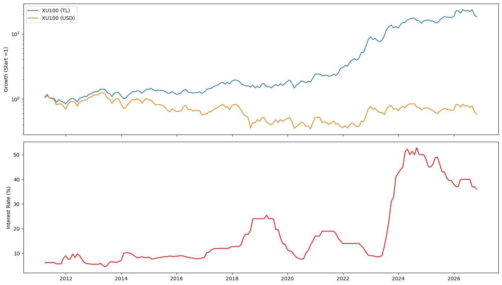
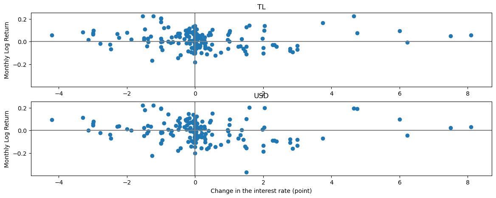
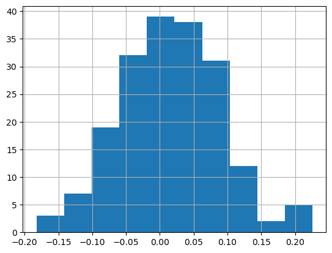
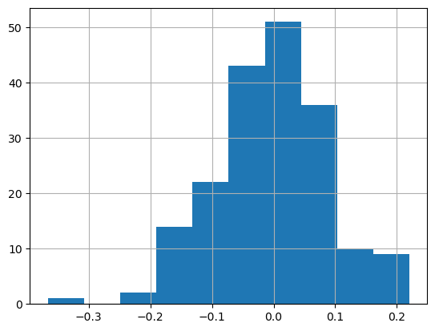
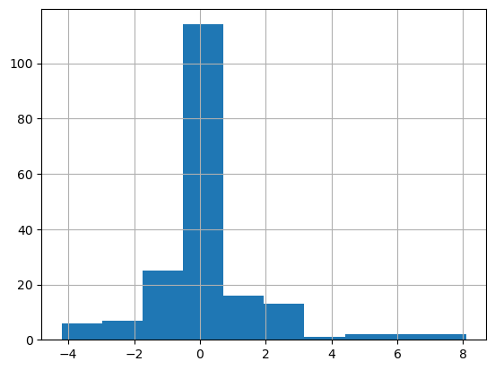
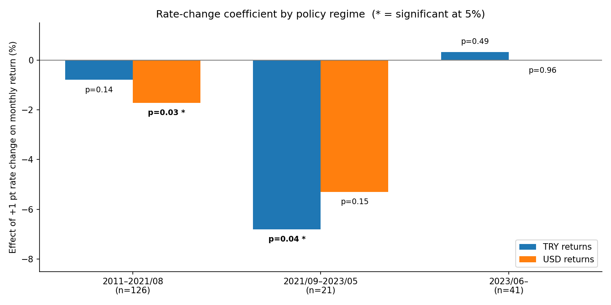
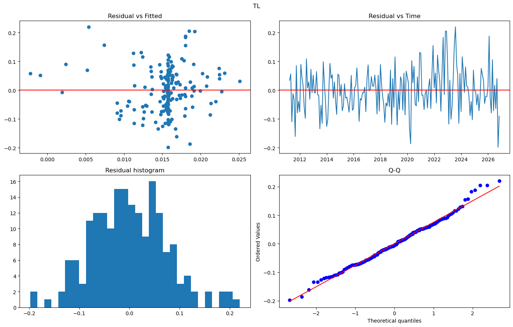
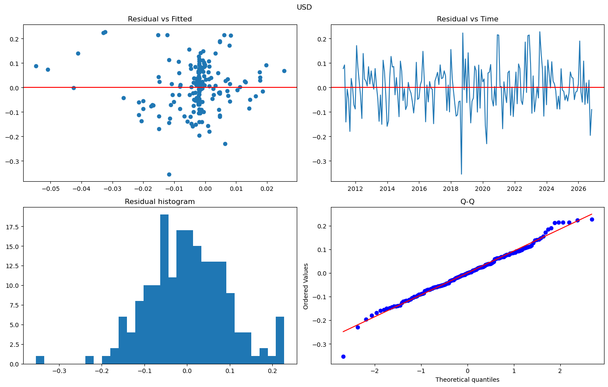

<div align="center">

# 📈 Interest Rates and BIST100 Returns

**Do changes in Turkish interest rates explain BIST100 returns, and does the relationship differ between TRY and USD terms?**


</div>

---

About 15 years of monthly data (2011–2026), simple linear regression, and three policy regimes. Built as an applied project after completing HKUST's *Python and Statistics for Financial Analysis* course.

This README shows the **actual outputs of the notebook** (charts, correlation tables and full regression summaries), so the results can be checked without running any code.

## 📑 Contents

[Key Findings](#-key-findings) · [Data](#-data) · [Method](#-method) · [Notebook Outputs](#-notebook-outputs) · [Limitations](#-limitations) · [How to Run](#-how-to-run)

## 🔑 Key Findings

| | Finding |
|---|---|
| 💱 | **Nominal gains largely reflect currency depreciation.** BIST100 rose about twentyfold in TRY terms but ended below its starting level in USD terms. |
| 🚫 | **No significant relationship in the full sample.** Rate changes explain at most 1.3% of monthly return variation and do not predict next month's returns. |
| 🔀 | **The relationship depends on the policy regime.** During the 2021–2023 easing period, each one-point cut was associated with a 6.8% higher monthly TRY return, with no significant effect in USD terms. |
| 📏 | **The effect depends on the size of the change.** Excluding the four largest hikes, a one-point hike is associated with a 1.3% lower monthly USD return (p = 0.01). Large, decisive hikes coincided with positive returns. |

## 🗂 Data

| Variable | Source | Notes |
|---|---|---|
| BIST100 index (`XU100.IS`) | Yahoo Finance via `yfinance` | Downloaded at runtime |
| USD/TRY exchange rate (`TRY=X`) | Yahoo Finance via `yfinance` | Downloaded at runtime |
| CBRT weighted average cost of funding (`TP_APIFON4`) | CBRT EVDS | Monthly, end-of-month value; included as `EVDS_25-10-2026.xlsx` |

> **Why monthly?** The policy rate changes only a few times a year. At daily frequency, the rate-change variable would be zero on almost every day.

## 🔬 Method

1. **Variables:** monthly log returns of BIST100 in TRY and USD terms, and monthly changes in the interest rate (percentage points)
2. **Descriptive analysis:** level charts, scatter plots, histograms, correlations
3. **Regressions:** returns on same-month and one-month-lagged rate changes
4. **Subperiods:** three policy regimes (2011–2021/08, 2021/09–2023/05 easing, 2023/06 onward)
5. **Diagnostics:** regression assumption checks and a robustness check excluding the largest rate hikes

## 📊 Notebook Outputs

### 1. Index levels vs. the policy rate



### 2. Rate changes vs. monthly returns



### 3. Distributions

| BIST100 return (TRY) | BIST100 return (USD) | Rate change (pp) |
|:---:|:---:|:---:|
|  |  |  |

### 4. Correlations

Same-month rate change:

```text
           ret_tl   ret_usd     ret_r
ret_tl   1.000000  0.860202 -0.048077
ret_usd  0.860202  1.000000 -0.113961
ret_r   -0.048077 -0.113961  1.000000
```

One-month lagged rate change:

```text
             ret_tl   ret_usd  ret_rlag1
ret_tl     1.000000  0.860202   0.029424
ret_usd    0.860202  1.000000   0.081989
ret_rlag1  0.029424  0.081989   1.000000
```

### 5. Regressions (full sample)

Summary of all four models:

```text
                     Coefficient         p        R²
TL Contemporaneous     -0.002224  0.512353  0.002311
USD Contemporaneous    -0.006538  0.119421  0.012987
TL lagged               0.001362  0.689334  0.000866
USD lagged              0.004701  0.264619  0.006722
```

Full statsmodels output for each model:

<details>
<summary>TRY returns ~ same-month rate change (<code>lm_tl</code>)</summary>

```text
                            OLS Regression Results                            
==============================================================================
Dep. Variable:                 ret_tl   R-squared:                       0.002
Model:                            OLS   Adj. R-squared:                 -0.003
Method:                 Least Squares   F-statistic:                    0.4309
Date:                Sun, 25 Oct 2026   Prob (F-statistic):              0.512
Time:                        19:56:56   Log-Likelihood:                 220.71
No. Observations:                 188   AIC:                            -437.4
Df Residuals:                     186   BIC:                            -431.0
Df Model:                           1                                         
Covariance Type:            nonrobust                                         
==============================================================================
                 coef    std err          t      P>|t|      [0.025      0.975]
------------------------------------------------------------------------------
Intercept      0.0158      0.006      2.861      0.005       0.005       0.027
ret_r         -0.0022      0.003     -0.656      0.512      -0.009       0.004
==============================================================================
Omnibus:                        3.075   Durbin-Watson:                   1.829
Prob(Omnibus):                  0.215   Jarque-Bera (JB):                2.656
Skew:                           0.267   Prob(JB):                        0.265
Kurtosis:                       3.233   Cond. No.                         1.64
==============================================================================

Notes:
[1] Standard Errors assume that the covariance matrix of the errors is correctly specified.
```

</details>

<details>
<summary>USD returns ~ same-month rate change (<code>lm_usd</code>)</summary>

```text
                            OLS Regression Results                            
==============================================================================
Dep. Variable:                ret_usd   R-squared:                       0.013
Model:                            OLS   Adj. R-squared:                  0.008
Method:                 Least Squares   F-statistic:                     2.447
Date:                Sun, 25 Oct 2026   Prob (F-statistic):              0.119
Time:                        19:56:56   Log-Likelihood:                 181.22
No. Observations:                 188   AIC:                            -358.4
Df Residuals:                     186   BIC:                            -352.0
Df Model:                           1                                         
Covariance Type:            nonrobust                                         
==============================================================================
                 coef    std err          t      P>|t|      [0.025      0.975]
------------------------------------------------------------------------------
Intercept     -0.0019      0.007     -0.273      0.785      -0.015       0.012
ret_r         -0.0065      0.004     -1.564      0.119      -0.015       0.002
==============================================================================
Omnibus:                        3.472   Durbin-Watson:                   1.893
Prob(Omnibus):                  0.176   Jarque-Bera (JB):                3.951
Skew:                          -0.067   Prob(JB):                        0.139
Kurtosis:                       3.697   Cond. No.                         1.64
==============================================================================

Notes:
[1] Standard Errors assume that the covariance matrix of the errors is correctly specified.
```

</details>

<details>
<summary>TRY returns ~ lagged rate change (<code>lm_tl_lag</code>)</summary>

```text
                            OLS Regression Results                            
==============================================================================
Dep. Variable:                 ret_tl   R-squared:                       0.001
Model:                            OLS   Adj. R-squared:                 -0.005
Method:                 Least Squares   F-statistic:                    0.1603
Date:                Sun, 25 Oct 2026   Prob (F-statistic):              0.689
Time:                        19:56:56   Log-Likelihood:                 219.01
No. Observations:                 187   AIC:                            -434.0
Df Residuals:                     185   BIC:                            -427.6
Df Model:                           1                                         
Covariance Type:            nonrobust                                         
==============================================================================
                 coef    std err          t      P>|t|      [0.025      0.975]
------------------------------------------------------------------------------
Intercept      0.0150      0.006      2.707      0.007       0.004       0.026
ret_rlag1      0.0014      0.003      0.400      0.689      -0.005       0.008
==============================================================================
Omnibus:                        2.741   Durbin-Watson:                   1.835
Prob(Omnibus):                  0.254   Jarque-Bera (JB):                2.360
Skew:                           0.260   Prob(JB):                        0.307
Kurtosis:                       3.181   Cond. No.                         1.65
==============================================================================

Notes:
[1] Standard Errors assume that the covariance matrix of the errors is correctly specified.
```

</details>

<details>
<summary>USD returns ~ lagged rate change (<code>lm_usd_lag</code>)</summary>

```text
                            OLS Regression Results                            
==============================================================================
Dep. Variable:                ret_usd   R-squared:                       0.007
Model:                            OLS   Adj. R-squared:                  0.001
Method:                 Least Squares   F-statistic:                     1.252
Date:                Sun, 25 Oct 2026   Prob (F-statistic):              0.265
Time:                        19:56:56   Log-Likelihood:                 179.52
No. Observations:                 187   AIC:                            -355.0
Df Residuals:                     185   BIC:                            -348.6
Df Model:                           1                                         
Covariance Type:            nonrobust                                         
==============================================================================
                 coef    std err          t      P>|t|      [0.025      0.975]
------------------------------------------------------------------------------
Intercept     -0.0041      0.007     -0.596      0.552      -0.018       0.009
ret_rlag1      0.0047      0.004      1.119      0.265      -0.004       0.013
==============================================================================
Omnibus:                        3.602   Durbin-Watson:                   1.893
Prob(Omnibus):                  0.165   Jarque-Bera (JB):                3.782
Skew:                          -0.145   Prob(JB):                        0.151
Kurtosis:                       3.634   Cond. No.                         1.65
==============================================================================

Notes:
[1] Standard Errors assume that the covariance matrix of the errors is correctly specified.
```

</details>


### 6. Subperiod analysis

```text
            Period   Return    n  Coefficient         p        R²
0     2011–2021/08   ret_tl  126    -0.007925  0.142979  0.017223
1     2011–2021/08  ret_usd  126    -0.017203  0.027239  0.038709
2  2021/09–2023/05   ret_tl   21    -0.067998  0.039095  0.205380
3  2021/09–2023/05  ret_usd   21    -0.052994  0.148088  0.106851
4         2023/06–   ret_tl   41     0.003267  0.494111  0.012070
5         2023/06–  ret_usd   41    -0.000232  0.960466  0.000064
```



*The bar chart above is drawn from the table output (coefficients ×100; \* marks p < 0.05).*

### 7. Assumption checks

| TRY model | USD model |
|:---:|:---:|
|  |  |

### 8. Robustness check: excluding rate changes of 5 points or more (n = 184)

<details>
<summary>TRY returns (<code>ret_tl ~ ret_r</code>)</summary>

```text
OLS Regression Results                            
==============================================================================
Dep. Variable:                 ret_tl   R-squared:                       0.013
Model:                            OLS   Adj. R-squared:                  0.008
Method:                 Least Squares   F-statistic:                     2.408
Date:                Sun, 25 Oct 2026   Prob (F-statistic):              0.122
Time:                        19:56:58   Log-Likelihood:                 215.86
No. Observations:                 184   AIC:                            -427.7
Df Residuals:                     182   BIC:                            -421.3
Df Model:                           1                                         
Covariance Type:            nonrobust                                         
==============================================================================
                 coef    std err          t      P>|t|      [0.025      0.975]
------------------------------------------------------------------------------
Intercept      0.0148      0.006      2.661      0.008       0.004       0.026
ret_r         -0.0067      0.004     -1.552      0.122      -0.015       0.002
==============================================================================
Omnibus:                        5.571   Durbin-Watson:                   1.857
Prob(Omnibus):                  0.062   Jarque-Bera (JB):                5.215
Skew:                           0.352   Prob(JB):                       0.0737
Kurtosis:                       3.431   Cond. No.                         1.28
==============================================================================

Notes:
[1] Standard Errors assume that the covariance matrix of the errors is correctly specified.
```

</details>

<details>
<summary>USD returns (<code>ret_usd ~ ret_r</code>)</summary>

```text
OLS Regression Results                            
==============================================================================
Dep. Variable:                ret_usd   R-squared:                       0.034
Model:                            OLS   Adj. R-squared:                  0.029
Method:                 Least Squares   F-statistic:                     6.370
Date:                Sun, 25 Oct 2026   Prob (F-statistic):             0.0125
Time:                        19:56:58   Log-Likelihood:                 178.15
No. Observations:                 184   AIC:                            -352.3
Df Residuals:                     182   BIC:                            -345.9
Df Model:                           1                                         
Covariance Type:            nonrobust                                         
==============================================================================
                 coef    std err          t      P>|t|      [0.025      0.975]
------------------------------------------------------------------------------
Intercept     -0.0034      0.007     -0.499      0.618      -0.017       0.010
ret_r         -0.0134      0.005     -2.524      0.012      -0.024      -0.003
==============================================================================
Omnibus:                        4.890   Durbin-Watson:                   1.925
Prob(Omnibus):                  0.087   Jarque-Bera (JB):                6.649
Skew:                           0.070   Prob(JB):                       0.0360
Kurtosis:                       3.921   Cond. No.                         1.28
==============================================================================

Notes:
[1] Standard Errors assume that the covariance matrix of the errors is correctly specified.
```

</details>


## ⚠️ Limitations

- Small, regime-dependent sample (188 months; only 21 in the easing period)
- Possible reverse causality: rates may respond to market and currency stress within the same month
- Nominal rates, with no inflation adjustment
- Heteroskedastic residuals
- Subsample and robustness tests are exploratory

See the conclusion section of the notebook for details.

## 🚀 How to Run

**Requirements:** Python 3 and the following packages:

```bash
pip install yfinance numpy pandas statsmodels matplotlib scipy openpyxl
```

**Steps:**

1. Keep `EVDS_25-10-2026.xlsx` in the same folder as the notebook.
2. Open `xu100interestrate.ipynb` and run all cells from top to bottom.
3. An internet connection is required, since BIST100 and USD/TRY data are downloaded from Yahoo Finance at runtime.

> Yahoo Finance data can be revised over time, so re-running the notebook later may give slightly different numbers than those shown above.

## 📁 Repository Structure

```
├── xu100interestrate.ipynb        # Full analysis
├── EVDS_25-10-2026.xlsx           # CBRT interest rate data (EVDS export)
├── assets/                        # Charts exported from the notebook
└── README.md
```

## 👤 Author

Metehan Çiftçi
